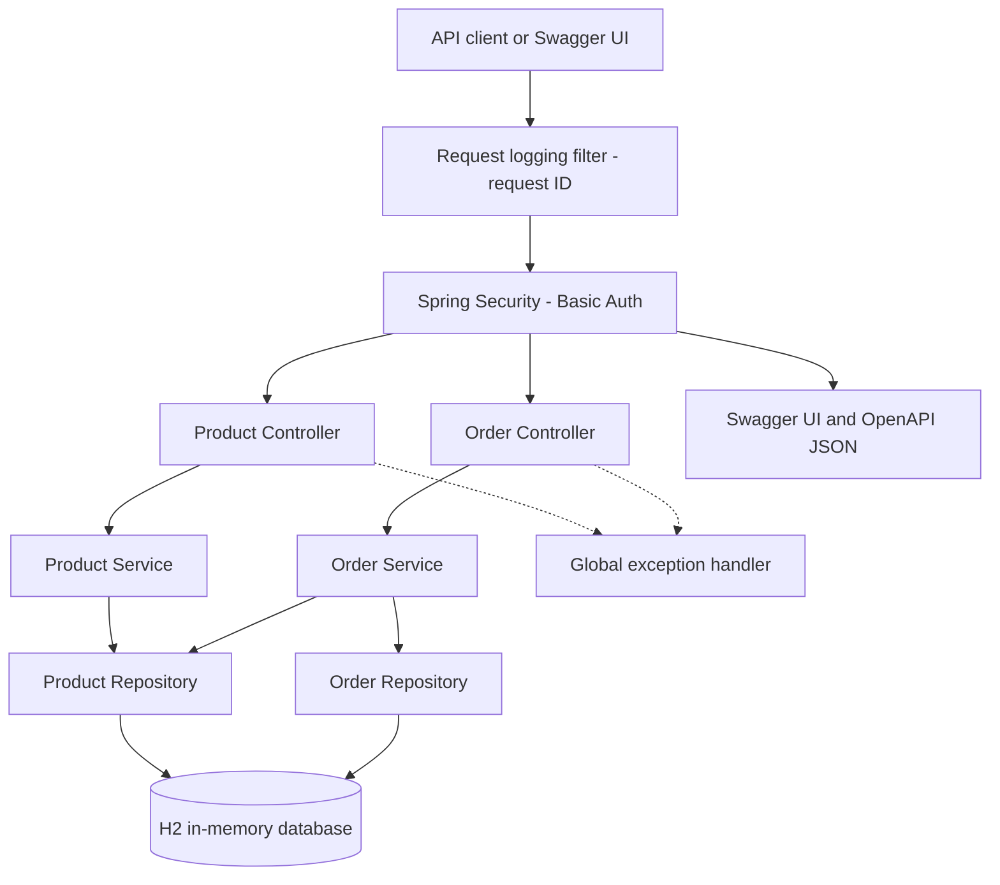
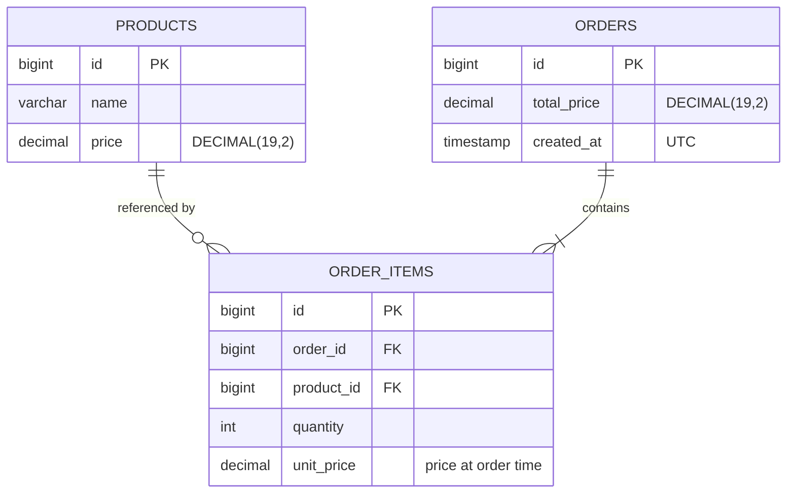

<!--
Steps
Explain the project and how to run it locally.
Show what has been implemented so far.
Show an order example and the database schema.
Add Docker and Kubernetes instructions once tested.
-->

# OrderFlow API

A small order management microservice built with **Java 21, Spring Boot and Maven** as part of a backend technical challenge.

The aim is to keep the service easy to understand and test, while making deliberate choices around validation, persistence and error handling. The project is being built in small steps; this README will change as each part is completed.

## Current progress

- **Phase 1 - Foundation:** Maven project, Spring Boot, in-memory H2 and HTTP Basic authentication.
- **Phase 2 - Products:** Create, retrieve and list products; request validation and initial unit/integration tests.
- **Phase 2 final check:** Confirm the Maven process exits successfully after verification.
- **Phase 3 - Orders (complete):** Order items, product existence checks, price snapshots and calculated totals in one transaction.
- **Phase 4 - Errors and tests (complete):** Consistent error responses and broader integration coverage.
- **Phase 5 - Documentation and logging (complete):** Request logging with request IDs, Swagger/OpenAPI behind authentication, and usage examples.
- **Phase 6 - Docker:** Container image and a simple local run option.
- **Phase 7 - Kubernetes/Rancher:** Optional single-replica deployment example.
- **Phase 8 - Final review:** Optional CI checks, cleanup and submission verification.

## Technology

- Java 21 and Spring Boot 4.1.1
- Maven Wrapper
- Spring MVC, Spring Data JPA and Jakarta Bean Validation
- H2 in-memory database
- Spring Security (HTTP Basic)
- Springdoc OpenAPI 3.1.1 (Swagger UI)
- JUnit 5, Mockito and Spring MVC integration tests

## Architecture (current)



The application uses a simple layered design: controllers handle HTTP, services apply business rules, and repositories handle database access. The order service also reads products (through the product repository) to check they exist and to copy their prices. The logging filter runs first so that even rejected (401) requests are logged, and one exception handler turns errors into consistent JSON responses.

### Database schema



`order_items` links an order to a product and also stores the quantity and the product's price at the moment of ordering. Line totals are not stored; they are calculated as `unit_price * quantity` when an order is returned.

## Run locally

**Requirements:** JDK 21. Maven does not need to be installed globally because the project includes the Maven Wrapper.

In PowerShell, make sure `JAVA_HOME` points to JDK 21, then run:

```powershell
.\mvnw.cmd clean verify

# Set your own local development credentials (do not commit them).
$env:ORDERFLOW_USER = "local-user"
$env:ORDERFLOW_PASSWORD = "replace-with-a-local-password"

.\mvnw.cmd spring-boot:run
```

The API uses the default local address `http://localhost:8080` unless configured otherwise. The application requires both credential variables at startup. All API routes require authentication.

To use another port, run the packaged jar with `java -jar target\orderflow-api-0.0.1-SNAPSHOT.jar --server.port=8089` (after `.\mvnw.cmd clean verify`, with the credential variables set).

**Note:** H2 is in memory. Data is lost when the application stops; this is intentional for the exercise.

Quick check from PowerShell once the app is running (use the credentials you set above):

```powershell
curl.exe -u "$env:ORDERFLOW_USER`:$env:ORDERFLOW_PASSWORD" http://localhost:8080/api/v1/products
```

## API documentation (Swagger)

With the application running:

- Swagger UI: `http://localhost:8080/swagger-ui/index.html`
- OpenAPI JSON: `http://localhost:8080/v3/api-docs`

Both require the same HTTP Basic credentials as the API; they are not public. Opening Swagger UI in a browser makes the browser ask for the username and password. Inside Swagger UI the **Authorize** button (scheme `basicAuth`) lets you enter them so that "Try it out" requests are authenticated. The documentation is generated from the controllers and DTOs by Springdoc, with a few short annotations for summaries and status codes.

## Logging

A small filter writes one line per request, after it completes:

```text
INFO [3f1c...] ... RequestLoggingFilter : request_id=3f1c... method=POST path=/api/v1/orders status=201 duration_ms=38
```

It also logs `Order created order_id=15 items=3` once an order has been committed; rejected orders do not produce this line.

**Request IDs:** if the client sends an `X-Request-ID` header made of letters, digits, `.`, `_` or `-` (up to 64 characters) it is kept; otherwise a UUID is generated. The effective ID is returned in the `X-Request-ID` response header and appears on every log line written during that request, so a client can quote it when reporting a problem.

Logs contain only the path, never the query string, `Authorization` header, credentials or request/response bodies.

## API status

| Method | Endpoint |
| --- | --- |
| `POST` | `/api/v1/products` |
| `GET` | `/api/v1/products/{id}` |
| `GET` | `/api/v1/products` |
| `POST` | `/api/v1/orders` |
| `GET` | `/api/v1/orders/{id}` |
| `GET` | `/api/v1/orders` |

Example product request:

```json
{
  "name": "Keyboard",
  "price": 450.00
}
```

Product names must not be blank, and prices must be positive with no more than two decimal places. The service assigns product IDs.

### Creating an order

```json
POST /api/v1/orders
{
  "items": [
    { "productId": 1, "quantity": 2 },
    { "productId": 2, "quantity": 1 }
  ]
}
```

Example response (`201 Created`, with a `Location` header pointing at the new order):

```json
{
  "id": 1,
  "items": [
    { "productId": 1, "productName": "Keyboard", "quantity": 2, "unitPrice": 450.00, "lineTotal": 900.00 },
    { "productId": 2, "productName": "Mouse", "quantity": 1, "unitPrice": 250.00, "lineTotal": 250.00 }
  ],
  "totalPrice": 1150.00,
  "createdAt": "2026-10-22T12:00:00Z"
}
```

Clients send only product IDs and quantities. Prices and totals always come from the server. Quantities must be whole numbers from 1 to 1000, an order needs at least one item, and the same product cannot appear twice in one order (`400`). If any product does not exist the whole order is rejected with `404`, and the response lists every missing ID in `missingProductIds`.

## Error handling

All endpoints require HTTP Basic authentication. Missing or wrong credentials return `401`; this is answered by Spring Security before the request reaches a controller, so it does not use the JSON format below.

Every other error is returned as an [RFC 9457](https://www.rfc-editor.org/rfc/rfc9457) problem details response (`application/problem+json`), handled in one class, `GlobalExceptionHandler`. Responses never contain stack traces, exception class names or database details.

| Situation | Status |
| --- | --- |
| Invalid fields, malformed JSON (including a fractional quantity such as `1.5`), duplicate product IDs in an order | `400` |
| Unknown product or order, or products missing from an order | `404` |

Validation error, with field errors sorted by field name:

```json
{
  "type": "about:blank",
  "title": "Bad Request",
  "status": 400,
  "detail": "Request validation failed",
  "instance": "/api/v1/products",
  "fieldErrors": [
    { "field": "name", "message": "must not be blank" }
  ]
}
```

Order that references products that do not exist (nothing is saved):

```json
{
  "type": "about:blank",
  "title": "Not Found",
  "status": 404,
  "detail": "One or more products were not found",
  "instance": "/api/v1/orders",
  "missingProductIds": [10, 20]
}
```

Unreadable JSON returns the fixed message `Malformed or invalid JSON request`. Unexpected server errors return a plain `500` without exception details (checked by a test); the cause is only written to the server log.

## Design notes

- **One service:** This domain does not need distributed services for the challenge.
- **Spring MVC:** The work is blocking JPA CRUD, so the simpler servlet stack fits better than WebFlux.
- **H2 in memory:** The exercise asks for it, and it makes the project easy to run and review.
- **DTOs separate from entities:** API contracts should not depend on database entities.
- **`BigDecimal` for money:** Avoid floating-point errors in prices and totals.
- **Validation at the boundary:** Reject invalid input before persisting it.
- **Price snapshots:** Each order item stores the product price at the time of ordering, so later price changes do not alter past orders.
- **Transactions for orders:** Order creation is one transaction. All checks run before saving, and the order and its items are saved together, so a failed order leaves no partial records.
- **Simple security:** HTTP Basic meets the exercise requirements without a separate identity system. It sends credentials with every request, so it should only be used over HTTPS outside local development.
- **Logging without bodies or credentials:** Request bodies and headers can contain personal data or secrets, so logs carry only the request ID, method, path, status and timing.

## Known limitations

- Data is lost when the application restarts, and the service must run as a single instance because H2 is in memory.
- Lists are not paginated.
- Products and orders cannot be updated or deleted.
- The demo uses one configured user; there are no roles or user management.

## Tests

Run all tests through Maven:

```powershell
.\mvnw.cmd clean verify
```

Current tests (102) cover product and order service behaviour, authenticated API requests, validation, exact decimal totals, price snapshots, missing products, H2 persistence, rollback of a failed order, the structure of every error response, an unexpected 500 error, request logging and request IDs, and the secured Swagger/OpenAPI endpoints.
