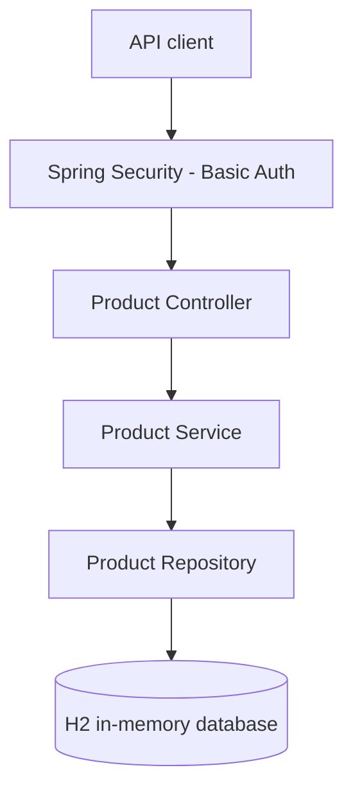

<!--
Steps
Explain the project and how to run it locally.
Show what has been implemented so far.
[ ] Add order examples when order management is complete.
[ ] Add Docker and Kubernetes instructions once tested.
-->

# OrderFlow API

A small order management microservice built with **Java 21, Spring Boot and Maven** as part of a backend technical challenge.

The aim is to keep the service easy to understand and test, while making deliberate choices around validation, persistence and error handling. The project is being built in small steps; this README will change as each part is completed.

## Current progress

- **Phase 1 - Foundation:** Maven project, Spring Boot, in-memory H2 and HTTP Basic authentication.
- **Phase 2 - Products:** Create, retrieve and list products; request validation and initial unit/integration tests.
- **Phase 2 final check:** Confirm the Maven process exits successfully after verification.
- **Phase 3 - Orders:** Order items, product existence checks, price snapshots and calculated totals in one transaction.
- **Phase 4 - Errors and tests:** Consistent error responses and broader integration coverage.
- **Phase 5 - Documentation and logging:** Meaningful request logging, Swagger/OpenAPI and usage examples.
- **Phase 6 - Docker:** Container image and a simple local run option.
- **Phase 7 - Kubernetes/Rancher:** Optional single-replica deployment example.
- **Phase 8 - Final review:** Optional CI checks, cleanup and submission verification.

## Technology

- Java 21 and Spring Boot 4.1.1
- Maven Wrapper
- Spring MVC, Spring Data JPA and Jakarta Bean Validation
- H2 in-memory database
- Spring Security (HTTP Basic)
- JUnit 5, Mockito and Spring MVC integration tests

## Architecture (current)



The application uses a simple layered design: controllers handle HTTP, services apply business rules, and repositories handle database access. Orders will follow the same structure when implemented.

## Run locally

**Requirements:** JDK 21. Maven does not need to be installed globally because the project includes the Maven Wrapper.

In PowerShell, make sure `JAVA_HOME` points to JDK 21, then run:

```powershell
.\mvnw.cmd clean verify

# Set your own local development credentials (do not commit them).
$env:ORDERFLOW_USER = "local-user"
$env:ORDERFLOW_PASSWORD = "replace-with-a-local-password"

.\mvnw.cmd spring-boot:run
```

The API uses the default local address `http://localhost:8080` unless configured otherwise. The application requires both credential variables at startup. All API routes require authentication.

**Note:** H2 is in memory. Data is lost when the application stops; this is intentional for the exercise.

## API status

| Method | Endpoint |
| --- | --- |
| `POST` | `/api/v1/products` |
| `GET` | `/api/v1/products/{id}` |
| `GET` | `/api/v1/products` |
| `POST` | `/api/v1/orders` |
| `GET` | `/api/v1/orders/{id}` |
| `GET` | `/api/v1/orders` |

Example product request:

```json
{
  "name": "Keyboard",
  "price": 450.00
}
```

Product names must not be blank, and prices must be positive with no more than two decimal places. The service assigns product IDs.

## Design notes

- **One service:** This domain does not need distributed services for the challenge.
- **DTOs separate from entities:** API contracts should not depend on database entities.
- **`BigDecimal` for money:** Avoid floating-point errors in prices and totals.
- **Validation at the boundary:** Reject invalid input before persisting it.
- **Transactions for orders:** When implemented, either the full order is saved or nothing is.
- **Simple security:** HTTP Basic meets the exercise requirements without a separate identity system.

## Tests

Run all tests through Maven:

```powershell
.\mvnw.cmd clean verify
```

Current tests cover product service behaviour, authenticated API requests, validation and H2 persistence. The remaining business rules will be tested as the Order functionality is added.
