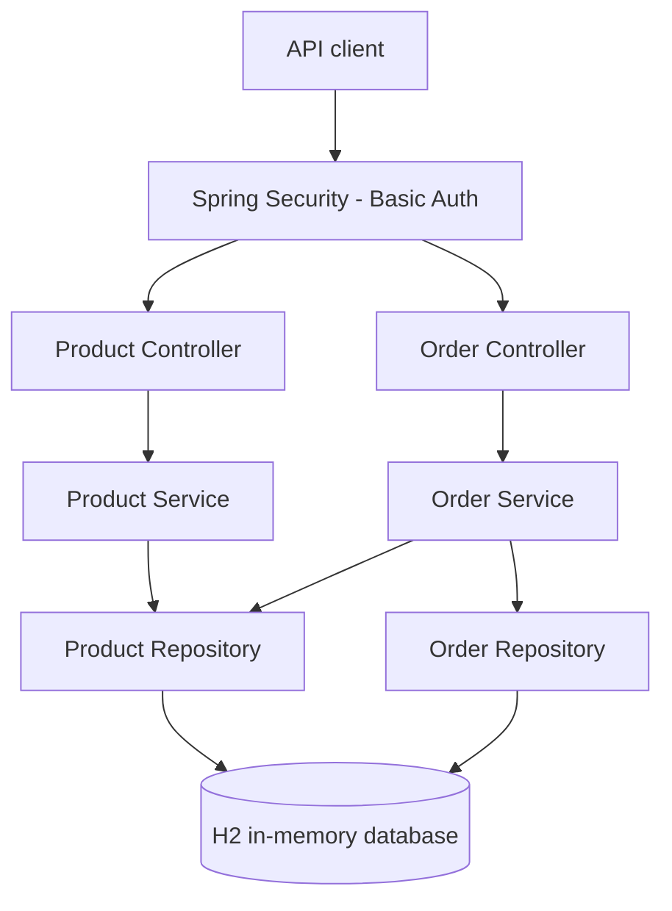
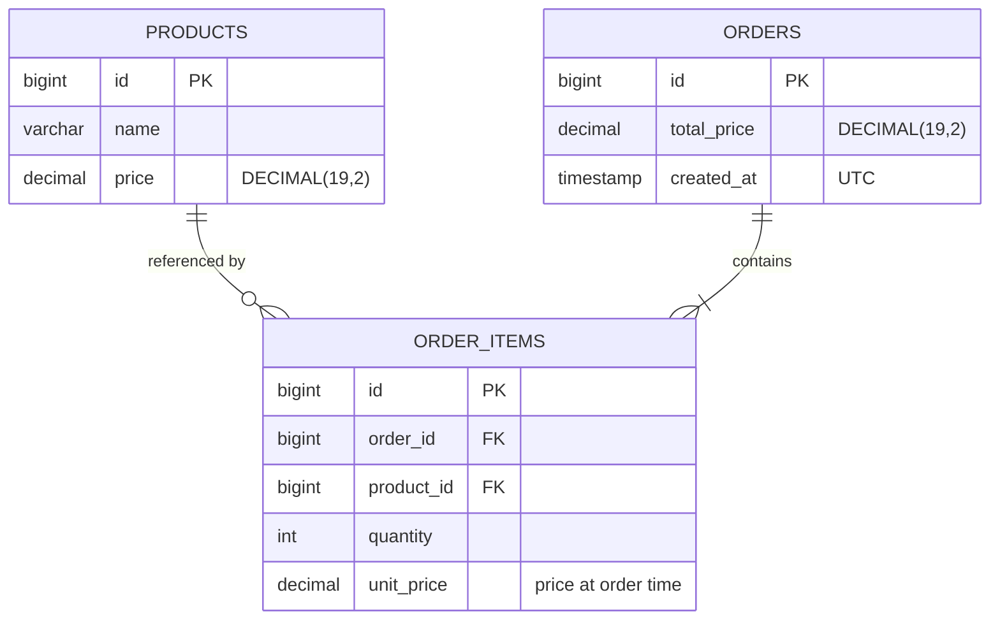

<!--
Steps
Explain the project and how to run it locally.
Show what has been implemented so far.
Show an order example and the database schema.
Add Docker and Kubernetes instructions once tested.
-->

# OrderFlow API

A small order management microservice built with **Java 21, Spring Boot and Maven** as part of a backend technical challenge.

The aim is to keep the service easy to understand and test, while making deliberate choices around validation, persistence and error handling. The project is being built in small steps; this README will change as each part is completed.

## Current progress

- **Phase 1 - Foundation:** Maven project, Spring Boot, in-memory H2 and HTTP Basic authentication.
- **Phase 2 - Products:** Create, retrieve and list products; request validation and initial unit/integration tests.
- **Phase 2 final check:** Confirm the Maven process exits successfully after verification.
- **Phase 3 - Orders (complete):** Order items, product existence checks, price snapshots and calculated totals in one transaction.
- **Phase 4 - Errors and tests:** Consistent error responses and broader integration coverage.
- **Phase 5 - Documentation and logging:** Meaningful request logging, Swagger/OpenAPI and usage examples.
- **Phase 6 - Docker:** Container image and a simple local run option.
- **Phase 7 - Kubernetes/Rancher:** Optional single-replica deployment example.
- **Phase 8 - Final review:** Optional CI checks, cleanup and submission verification.

## Technology

- Java 21 and Spring Boot 4.1.1
- Maven Wrapper
- Spring MVC, Spring Data JPA and Jakarta Bean Validation
- H2 in-memory database
- Spring Security (HTTP Basic)
- JUnit 5, Mockito and Spring MVC integration tests

## Architecture (current)



The application uses a simple layered design: controllers handle HTTP, services apply business rules, and repositories handle database access. The order service also reads products (through the product repository) to check they exist and to copy their prices.

### Database schema



`order_items` links an order to a product and also stores the quantity and the product's price at the moment of ordering. Line totals are not stored; they are calculated as `unit_price * quantity` when an order is returned.

## Run locally

**Requirements:** JDK 21. Maven does not need to be installed globally because the project includes the Maven Wrapper.

In PowerShell, make sure `JAVA_HOME` points to JDK 21, then run:

```powershell
.\mvnw.cmd clean verify

# Set your own local development credentials (do not commit them).
$env:ORDERFLOW_USER = "local-user"
$env:ORDERFLOW_PASSWORD = "replace-with-a-local-password"

.\mvnw.cmd spring-boot:run
```

The API uses the default local address `http://localhost:8080` unless configured otherwise. The application requires both credential variables at startup. All API routes require authentication.

**Note:** H2 is in memory. Data is lost when the application stops; this is intentional for the exercise.

## API status

| Method | Endpoint |
| --- | --- |
| `POST` | `/api/v1/products` |
| `GET` | `/api/v1/products/{id}` |
| `GET` | `/api/v1/products` |
| `POST` | `/api/v1/orders` |
| `GET` | `/api/v1/orders/{id}` |
| `GET` | `/api/v1/orders` |

Example product request:

```json
{
  "name": "Keyboard",
  "price": 450.00
}
```

Product names must not be blank, and prices must be positive with no more than two decimal places. The service assigns product IDs.

### Creating an order

```json
POST /api/v1/orders
{
  "items": [
    { "productId": 1, "quantity": 2 },
    { "productId": 2, "quantity": 1 }
  ]
}
```

Example response (`201 Created`, with a `Location` header pointing at the new order):

```json
{
  "id": 1,
  "items": [
    { "productId": 1, "productName": "Keyboard", "quantity": 2, "unitPrice": 450.00, "lineTotal": 900.00 },
    { "productId": 2, "productName": "Mouse", "quantity": 1, "unitPrice": 250.00, "lineTotal": 250.00 }
  ],
  "totalPrice": 1150.00,
  "createdAt": "2026-10-22T12:00:00Z"
}
```

Clients send only product IDs and quantities. Prices and totals always come from the server. Quantities must be whole numbers from 1 to 1000, an order needs at least one item, and the same product cannot appear twice in one order (`400`). If any product does not exist the whole order is rejected with `404`, and the response lists every missing ID in `missingProductIds`.

## Design notes

- **One service:** This domain does not need distributed services for the challenge.
- **DTOs separate from entities:** API contracts should not depend on database entities.
- **`BigDecimal` for money:** Avoid floating-point errors in prices and totals.
- **Validation at the boundary:** Reject invalid input before persisting it.
- **Price snapshots:** Each order item stores the product price at the time of ordering, so later price changes do not alter past orders.
- **Transactions for orders:** Order creation is one transaction. All checks run before saving, and the order and its items are saved together, so a failed order leaves no partial records.
- **Simple security:** HTTP Basic meets the exercise requirements without a separate identity system.

## Tests

Run all tests through Maven:

```powershell
.\mvnw.cmd clean verify
```

Current tests (61) cover product and order service behaviour, authenticated API requests, validation, exact decimal totals, price snapshots, missing products, H2 persistence, and rollback of a failed order. Error responses are still the framework defaults; consistent error handling comes in a later phase.
